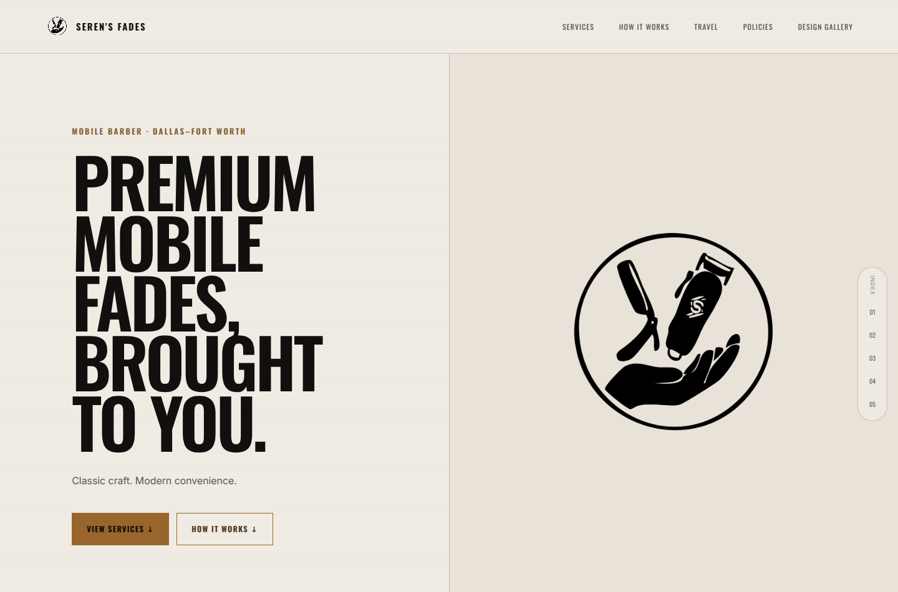
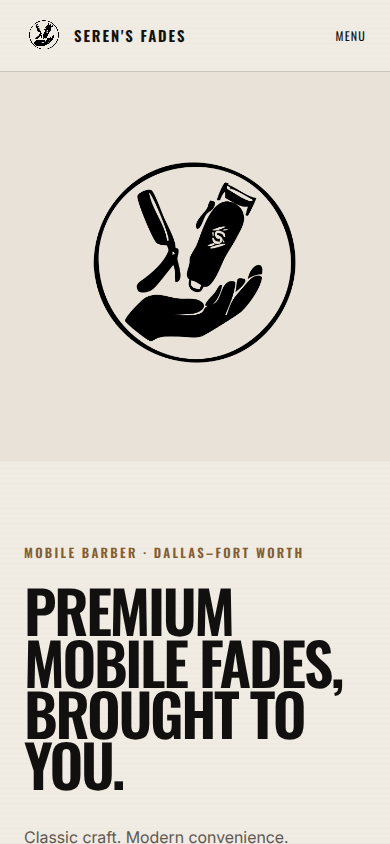
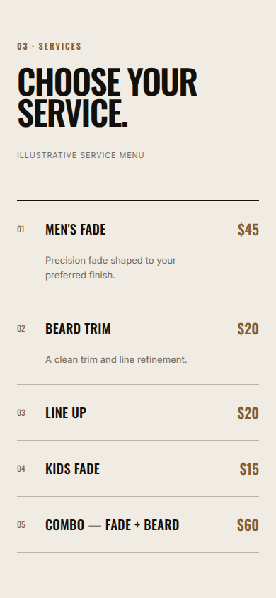
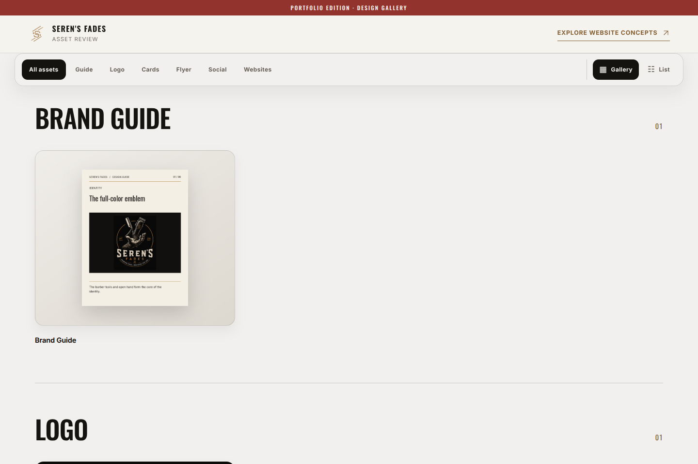

# Seren’s Fades

A responsive website and design gallery for a Dallas–Fort Worth mobile barber. **Modern Heritage** is the homepage. It pairs the one-color barber mark with oversized condensed type, then leads visitors through the service menu, appointment process, and travel information.



## The mobile experience

On smaller screens the logo sits above the headline, the navigation folds into a menu, and each service opens to show its description. The prices shown are illustrative. This portfolio edition accepts no bookings, payments, or customer information.

| Homepage | Service menu |
| --- | --- |
|  |  |

## Three design directions

The three directions share a service menu and brand identity. Their different layouts show how the same content can serve different visitor needs.

| Direction | What to look for | Screenshot |
| --- | --- | --- |
| Modern Heritage | A warm-white split layout, one-color mark, and a section index for longer service and policy content. | [View Modern Heritage](public/assets/concept-heritage.png) |
| Editorial Concierge | An asymmetric dark layout that moves directly from the brand promise to the service menu. | [View Editorial Concierge](public/assets/concept-editorial.png) |
| Doorstep Journey | A centered opening and a three-step explanation of how a mobile barber visit works. | [View Doorstep Journey](public/assets/concept-doorstep.png) |

## Design gallery

Open **Design gallery** from the homepage to explore 11 items across six categories. Switch between gallery and list views, open the eight-page brand guide, inspect both sides of a business card, or compare a social graphic at desktop and mobile crops. Individual items can be shared by URL fragment, such as `/design-review/#asset-brand-guide`.



The public gallery uses the project’s logo variants and newly prepared print and social examples. The photographs and licensed mockup scenes from the private stakeholder materials are excluded from the public assets.

## Run locally

With Node.js 22.13 or newer and npm installed, run:

```sh
npm ci
npm run dev
```

Open **http://127.0.0.1:3000**. The homepage is at `/`, the gallery at `/design-review/`, and each direction has its own route under `/concepts/`. The site uses Next.js and TypeScript and exports static HTML. It needs no credentials, database, or external image service.

```sh
npm test
npm run lint
```

`npm test` builds the static site in `out/` and checks all five pages, their rendered images, and in-page navigation. The [shared website component](app/concepts/concept-demo.tsx) contains the variant layouts. The [gallery component](app/asset-review-hub.tsx) handles filters, deep links, preview contexts, and page navigation. Font licenses accompany the [self-hosted fonts](public/fonts/).
